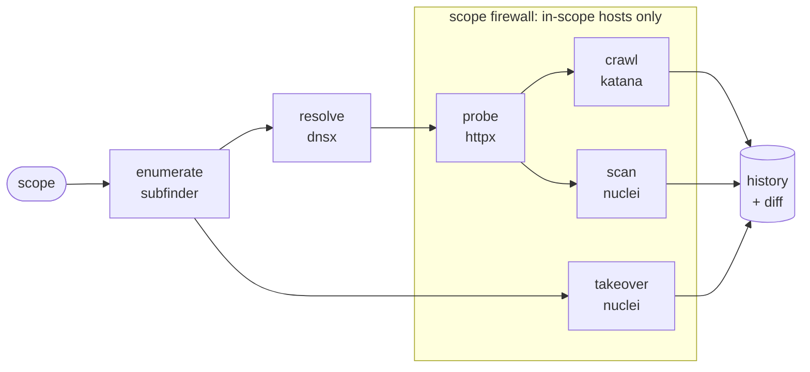

<p align="center">
  
</p>

<h3 align="center">Recon that cannot leave scope, and can prove it.</h3>

<p align="center">
  
  
  
  
</p>

<p align="center">
  <a href="#install">Install</a> ·
  <a href="#quick-start">Quick start</a> ·
  <a href="#scope-firewall">Scope firewall</a> ·
  <a href="#programs-and-rules">Programs and rules</a> ·
  <a href="#scope">Scope</a> ·
  <a href="#history-and-diff">History and diff</a> ·
  <a href="#options">Options</a>
</p>

---

Reconic runs [subfinder](https://github.com/projectdiscovery/subfinder), [dnsx](https://github.com/projectdiscovery/dnsx), [httpx](https://github.com/projectdiscovery/httpx), [katana](https://github.com/projectdiscovery/katana) and [nuclei](https://github.com/projectdiscovery/nuclei) as one pipeline. It does not reimplement them; it adds the parts that are easy to get wrong when you chain them by hand.

- **🛡️ Scope is enforced on the wire.** httpx, katana and nuclei run behind a local [scope firewall](#scope-firewall) that refuses any connection to an out-of-scope host. Every run keeps a receipt of what was contacted and what was blocked.
- **📜 It knows the program's rules.** `--program h1:handle` imports a HackerOne program's scope, and a small [rules file](#programs-and-rules) adds what the policy says: rate limit, required header, forbidden paths, allowed hours. Each run ends with a one-page `receipt.md` you can attach to a report.
- **🎯 Scope is never widened.** Hosts are checked before and after every tool. Give it one host and it tests one host, not the parent domain.
- **🔊 Failures are loud.** A missing tool, a crash or a timeout marks the stage as failed with the tool's own error, and the run exits non-zero. Partial results are kept and labelled, also after Ctrl-C.
- **🔁 Every run is remembered.** Each scan ends with what is new since the last one, and a webhook can send you only the new items.

## What a run looks like

```console
$ reconic scan -d example.com -x admin.example.com
  Scope
    + example.com
    + *.example.com
    - admin.example.com
  Firewall    on: httpx, katana and nuclei can only connect to in-scope hosts

  ✓ enumerate  3 host(s) · 2 out of scope dropped · 4.2s
  ✓ resolve    3 resolving · 1.1s
  ✓ probe      3 alive · 1.9s
  ✓ crawl      6 endpoint(s) · 1 out of scope dropped · 2 blocked by firewall · 31.0s
  ✓ takeover   1 finding(s) · 48.5s
  ✓ nuclei     1 finding(s) · 1 out of scope dropped · 602.3s

  3 host(s) · 3 alive · 6 endpoint(s) · 2 finding(s)
    high     github-takeover  example.com
    medium   exposed-git-config  https://example.com/.git/config

  Firewall  412 connection(s) to 3 in-scope host(s) · 2 blocked
    blocked  tracker.other-company.net  2x in crawl
    receipt: reconic_output/example.com/20261110-235317/scope_receipt.jsonl

  Run 2: new since run 1 (2026-11-10 21:53 UTC)
    + host      staging.example.com
    + alive     https://staging.example.com  [200]
    + 2 endpoint(s)
```

## How it works



| Stage | Tool | What it does |
|---|---|---|
| `enumerate` | subfinder | Finds subdomains of every wildcard domain in scope. Passive: nothing is sent to the target. |
| `resolve` | dnsx | Drops hosts with no address so they are not probed. Optional. |
| `probe` | httpx | Finds which hosts answer over HTTP, with status, title and technologies. |
| `crawl` | katana | Collects endpoints from pages, JavaScript, `robots.txt` and `sitemap.xml`. |
| `takeover` | nuclei | Runs the takeover templates against every in-scope hostname, including names that no longer resolve. |
| `nuclei` | nuclei | Runs critical, high and medium templates against the alive hosts. |

## Install

Reconic needs Python 3.9+ and has no Python dependencies.

```bash
git clone https://github.com/othmanXP/Reconic.git
cd Reconic
pipx install .          # or: pip install .
```

Then install the tools it drives (Go 1.21+):

```bash
go install github.com/projectdiscovery/subfinder/v2/cmd/subfinder@latest
go install github.com/projectdiscovery/dnsx/cmd/dnsx@latest          # optional
go install github.com/projectdiscovery/httpx/cmd/httpx@latest
go install github.com/projectdiscovery/katana/cmd/katana@latest
go install github.com/projectdiscovery/nuclei/v3/cmd/nuclei@latest
```

`reconic doctor` shows what it found. Tools are recognised by their version banner, not their file name, so the unrelated Python `httpx` is skipped, and `~/go/bin` is searched even when it is not on your `PATH`.

```console
$ reconic doctor
  ✓ subfinder  v2.14.0    /usr/bin/subfinder
  ✓ dnsx       v1.3.1     /home/you/go/bin/dnsx
  ✓ httpx      v1.9.0     /home/you/go/bin/httpx
  ✓ katana     v1.6.1     /home/you/go/bin/katana
  ✓ nuclei     v3.9.0     /usr/bin/nuclei
```

## Quick start

```bash
reconic scan -d example.com                  # a domain and all its subdomains
reconic scan -u app.example.com              # one host, no enumeration
reconic scan -d example.com --passive        # enumeration only, nothing sent to the target
reconic scan --scope scope.txt --rate-limit 20 -H "X-Bug-Bounty: yourname"
reconic scan --program h1:acme               # a HackerOne program's scope and your rules for it
reconic scan -d example.com -y --notify https://hooks.slack.com/services/...
```

Active scans ask you to confirm that you are authorized to test the scope; `-y` confirms up front for scheduled jobs. Ctrl-C stops the run but keeps everything it found, and records it in the history as incomplete.

## Scope firewall

Filtering what goes into and out of a tool does not control what the tool itself sends. A redirect, a template or a script tag can still make it request another host. So during the active stages Reconic runs a small proxy on `127.0.0.1` and starts httpx, katana and nuclei behind it. The proxy connects to in-scope hosts and refuses everything else.

Every decision is written to `scope_receipt.jsonl` in the run directory as it happens:

```json
{"time": "2026-11-10T21:54:02.117+00:00", "stage": "crawl", "action": "allowed", "host": "www.example.com", "port": 443, "via": "connect"}
{"time": "2026-11-10T21:54:02.340+00:00", "stage": "crawl", "action": "blocked", "host": "tracker.other-company.net", "port": 443, "via": "connect"}
```

Blocked counts show on each stage line and in the summary, and `results.json` holds the same under `firewall`.

With `--proxy` or `--tor`, the firewall chains to your proxy and the tools are given its SOCKS5 side, so nothing can connect around your proxy. `--no-firewall` turns it off.

<details>
<summary><b>What the firewall does not cover</b></summary>
<br>

- **nuclei's non-HTTP templates** (raw TCP, TLS, DNS) ignore an HTTP proxy. They connect to the in-scope host they were given, but they are not in the receipt. With `--proxy` or `--tor` they arrive as bare addresses and are blocked unless the address itself is in scope.
- **subfinder and dnsx** ask third-party sources and DNS resolvers, never the target, so they do not go through the firewall.
- **katana's Burp check.** katana asks every proxy for a host called `burpsuite`. That request is refused and recorded with a note, and is not counted as blocked.

</details>

## Programs and rules

`--program h1:<handle>` builds the scope from the program's structured scopes on HackerOne: in-scope assets are included and out-of-scope assets excluded. It needs your [API identifier and token](https://hackerone.com/settings/api_token/edit) in `HACKERONE_API_USERNAME` and `HACKERONE_API_TOKEN`.

```console
$ reconic scan --program h1:acme
  Program     h1:acme: 4 in scope, 2 out of scope · cached as program_scope.json
    · com.acme.android: skipped: not a web asset (GOOGLE_PLAY_APP_ID)
    · https://acme.com/api/: skipped: only /api/ is in scope and Reconic tests whole hosts; ...
  Rules       5 req/s · header X-HackerOne-Research · forbid /logout /checkout · hours 22:00-06:00 UTC
```

Asset lists can be imported, but rules live in the policy's free text. So each program gets a small rules file that you fill in once from its policy. The first `--program` run writes a template to `~/.config/reconic/programs/h1-<handle>.rules`:

```text
rate-limit: 5                              max requests per second, given to every tool
header: X-HackerOne-Research: yourname     sent with every request (repeatable)
forbid: /logout                            path no tool is pointed at or crawls into (repeatable)
forbid: /account/*/delete
exclude: blog.acme.com                     extra out-of-scope pattern (repeatable)
hours: 22:00-06:00                         scans only start inside this window
timezone: Europe/Amsterdam                 time zone of hours (default UTC)
```

A rule can only make a scan gentler or narrower: the lower of `rate-limit` and `--rate-limit` wins, and headers and exclusions add to the ones from flags. A misspelled rule is an error, not silently ignored. `--rules FILE` uses another file, with or without `--program`.

Every active run writes `receipt.md`: hosts contacted and how often, everything blocked and why, and each tool's route, rate limit and headers (names only). It ends with the SHA-256 of the full `scope_receipt.jsonl`.

<details>
<summary><b>How program entries are read</b></summary>
<br>

Identifiers on HackerOne are typed by hand. Each entry becomes scope patterns, or is skipped with a note. When an entry cannot be read exactly it is skipped, never guessed, so an import does not widen the scope.

| Entry | Becomes |
|---|---|
| `https://app.acme.com/` | `app.acme.com` |
| `app.acme.com:8443` | `app.acme.com`, probed on port 8443 |
| `*.acme.com`, `https://*.acme.com/*` | `*.acme.com` |
| `a.acme.com, b.acme.com` | both hosts |
| `www.acme.com (main site)` | `www.acme.com` |
| `*acme.com` | `acme.com` and `*.acme.com`, not `evil-acme.com` |
| `10.0.0.0/24`, `192.0.2.1-192.0.2.20` | the networks they cover |
| `https://acme.com/api/` in scope | skipped: Reconic tests whole hosts, so taking `acme.com` would test more than `/api/` |
| `https://acme.com/blog` out of scope | `acme.com` is excluded entirely, which is narrower |
| app store IDs, source code, hardware, … | skipped with a note |
| `Any host on acme.com`, `*.com` | skipped with a note; when such an entry is out of scope it is shown as a warning, since it is **not** excluded |

The fetched scope, with the raw API answer, is saved as `program_scope.json` in the run directory, and `results.json` records what was imported and every note. The request to HackerOne goes directly to `api.hackerone.com`, not through `--proxy`. Nothing is sent to the target.

</details>

<details>
<summary><b>How each rule is enforced</b></summary>
<br>

| Rule | Enforced by |
|---|---|
| `rate-limit` | every tool's own rate flag (`-rl`) |
| `header` | every tool that contacts the target (`-H`). For plain-HTTP requests the firewall also checks the header is on the wire and records the result in the receipt. |
| `forbid` | URLs with a forbidden path are not handed to katana or nuclei. katana gets them as out-of-scope crawl rules. Plain-HTTP requests for them are refused by the firewall. |
| `exclude` | added to the scope, so it is enforced everywhere the scope is |
| `hours` | checked before an active scan starts. A scan that is already running is not stopped when the window closes. Passive and DNS-only runs send nothing to the target and are not held to it. |

HTTPS is tunnelled through the firewall unopened, so for HTTPS the firewall sees hosts but not paths or headers. There the path and header rules rely on the tools' own flags, and the receipt says so.

</details>

## Scope

Exclusions always win.

| Pattern | Matches | Scan starts from |
|---|---|---|
| `app.example.com` | exactly that host | the host itself |
| `app.example.com:8443` | that host, on any port | probing that port |
| `*.example.com` | every subdomain at any depth, not `example.com` itself | enumerating `example.com` |
| `api-*.example.com` | `api-v2.example.com`, `api-eu.example.com`, … | enumerating `example.com`, keeping matches |
| `10.0.0.0/24` | every address in the network | every address, up to 65,536 per scan |

A pattern with no fixed domain, such as `example.*`, can only filter, and a scope made of nothing else is refused.

Set the scope with flags, a file, or both:

```bash
-d example.com          # example.com and *.example.com, enumerated
-u app.example.com      # that one host; a URL works too
-x admin.example.com    # keep a pattern out
--scope scope.txt       # patterns from a file
--program h1:acme       # a HackerOne program's in-scope and out-of-scope assets
--rules acme.rules      # rules of engagement; may add exclusions, never inclusions
```

```text
# scope.txt: one pattern per line, ! excludes, # comments
*.example.com
example.com
!admin.example.com
!*.corp.example.com
```

Beyond the firewall, out-of-scope hosts returned by a tool are dropped before the next stage, katana gets the scope as crawl rules, and httpx does not follow redirects (the `Location` header is recorded instead).

## History and diff

Every run is saved to `reconic_output/reconic.db`.

```console
$ reconic diff example.com
example.com  run 1 (2026-11-10 21:53 UTC) -> run 2 (2026-11-11 21:53 UTC)

hosts      +1 -1
  + staging.example.com
  - api.example.com
alive      +1 -1
  + https://staging.example.com  [200]
  - https://api.example.com
takeovers  no change
vulns      no change
```

- `reconic runs` lists recorded runs. `reconic diff` compares the latest two; `--old` and `--new` pick others, `--json` is for scripts.
- A stage that failed or was skipped in either run shows as `not compared`, not as everything having disappeared.
- An asset that went away and came back is marked `(seen before)`, and a note is shown when the scope changed.
- `--name NAME` sets the name a target is tracked under; by default it is the first scope pattern.

<details>
<summary><b>Notifications</b></summary>
<br>

`--notify WEBHOOK` posts what is new to Slack, Discord, or as JSON to any other URL. It can be repeated, and URLs are also read from `RECONIC_NOTIFY` so they stay out of your shell history.

```text
Reconic: example.com run 7, 6 new
+ host staging.example.com
+ alive https://staging.example.com  [200]
+ vuln [high] exposed-env https://staging.example.com/.env
+ 3 endpoint(s)
```

- Nothing is sent when nothing is new, so a daily scan stays quiet until something changes.
- The first run of a target sends totals and findings only, and an interrupted run sends nothing.
- A failed notification is reported but does not fail the scan. Notifications are sent directly, not through `--proxy`.

</details>

## Options

<details>
<summary><b>Stages</b></summary>
<br>

| Option | Meaning |
|---|---|
| `--passive` | enumeration only; nothing is sent to the target |
| `--dns-only` | enumerate and resolve only; no HTTP request is sent |
| `--no-resolve`, `--no-crawl`, `--no-takeover`, `--no-nuclei` | skip a stage |
| `--pick` | choose which alive hosts to continue with after probing |

</details>

<details>
<summary><b>Network</b></summary>
<br>

| Option | Meaning |
|---|---|
| `--proxy URL`, `--tor` | send every tool through a proxy; `--tor` is `socks5://127.0.0.1:9050` |
| `--no-firewall` | do not route httpx, katana and nuclei through the scope firewall |
| `-H "Name: value"`, `--cookie COOKIE` | header sent with every request to the target |
| `--rate-limit N` | maximum requests per second, per tool |
| `--threads N` | httpx threads (default 50) |

- A tool that cannot be proxied refuses to run rather than connect directly, and `resolve` is skipped because dnsx cannot use a proxy. With the firewall on, the proxy must be `http`, `https` or `socks5`.
- Headers are never sent to subfinder's third-party sources, and they are redacted in the saved command lines.

</details>

<details>
<summary><b>Tuning</b></summary>
<br>

| Option | Meaning |
|---|---|
| `--all-sources` | subfinder: use every source (slower) |
| `--depth N` | crawl depth (default 3) |
| `--headless` | katana: crawl with a headless browser |
| `--crawl-minutes N` | katana: maximum crawl time per target (default 10) |
| `--severity LIST` | nuclei severities (default `critical,high,medium`) |
| `--templates DIR` | nuclei: custom templates |
| `--stage-timeout MIN` | hard limit per stage; the tool and everything it started is stopped (default 60) |

</details>

<details>
<summary><b>Output</b></summary>
<br>

| Option | Meaning |
|---|---|
| `-o DIR` | where runs and the history are kept (default `./reconic_output`) |
| `--name NAME` | name the target is tracked under in the history |
| `--notify WEBHOOK` | send what is new to a Slack, Discord or generic webhook |
| `-y` | confirm authorization without the prompt |

</details>

## Output

Each run gets its own directory, so runs never mix:

```text
reconic_output/
├── reconic.db                      history of every run
└── example.com/
    └── 20261110-235317/
        ├── results.json            everything, including each stage's status
        ├── subdomains.txt  resolved.txt  alive.txt  endpoints.txt
        ├── findings.jsonl
        ├── scope_receipt.jsonl     every connection the firewall allowed or blocked
        ├── receipt.md              one-page summary of the above, for a report
        ├── program_scope.json      the imported program scope (with --program)
        └── raw/                    each tool's input, command line, stdout and stderr
```

Progress goes to stderr and the path of `results.json` to stdout. Exit codes: `0` every stage completed, `1` a stage failed or timed out, `2` the scan did not start, `130` stopped with Ctrl-C.

## Status

> [!NOTE]
> Reconic 2 is an alpha. It has run end to end against a real single-host scope, and enumeration and DNS resolution against a real wildcard domain. A full active scan of a large wildcard scope has not been done yet, and the scope firewall has been tested with the real tools against a local server only. A full active scan with a rules file has been run against a local DVWA: about 11,800 connections, all to the one in-scope host, with forbidden paths and callbacks to other hosts refused. Chaining the firewall to Tor has been tested through a real Tor client. The tests pass on Python 3.9, 3.10 and 3.14, including Ctrl-C. Program import has been tested against a local stand-in for the HackerOne API, not the live one. Please report rough edges.

## Development

The tests run the whole pipeline against stand-in tool binaries and local sockets, so they need no network and scan nothing:

```bash
pip install pytest
python -m pytest
```

## Responsible use

> [!IMPORTANT]
> Only scan systems you own or have explicit written permission to test. Scanning without authorization is illegal in most places. Respect each program's rules and rate limits; you are responsible for how you use this tool.

## License and credits

[MIT](LICENSE). Created by Othman Kamal, standing on [ProjectDiscovery](https://projectdiscovery.io/)'s subfinder, dnsx, httpx, katana and nuclei.
