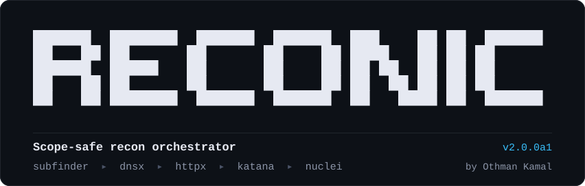
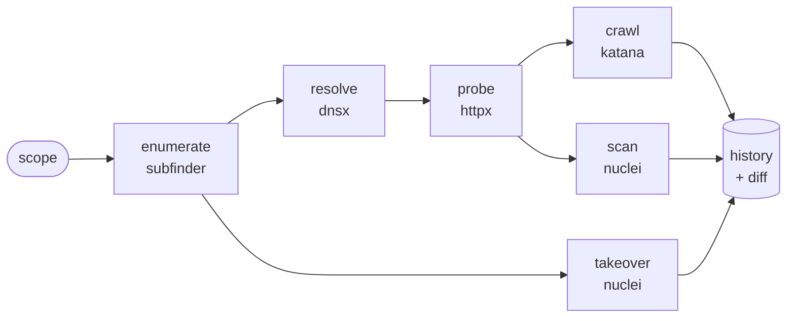

<p align="center">
  
</p>

<p align="center">
  <b>Recon that stays in scope, never hides a failure, and tells you what changed.</b>
</p>

<p align="center">
  
  
  
  
</p>

<p align="center">
  <a href="#install">Install</a> ·
  <a href="#quick-start">Quick start</a> ·
  <a href="#scope">Scope</a> ·
  <a href="#scope-firewall">Scope firewall</a> ·
  <a href="#history-and-diff">History and diff</a> ·
  <a href="#options">Options</a>
</p>

---

Reconic runs [subfinder](https://github.com/projectdiscovery/subfinder), [dnsx](https://github.com/projectdiscovery/dnsx), [httpx](https://github.com/projectdiscovery/httpx), [katana](https://github.com/projectdiscovery/katana) and [nuclei](https://github.com/projectdiscovery/nuclei) as one pipeline. It does not reimplement them. What it adds is the part that is easy to get wrong when you chain them by hand:

| | |
|---|---|
| **Scope is enforced everywhere** | Hosts are checked against your scope before and after every tool. Give it one host and it tests one host; it never widens to the parent domain. |
| **Scope is enforced on the wire** | httpx, katana and nuclei run behind a local [scope firewall](#scope-firewall) that refuses any connection to an out-of-scope host, and every run keeps a receipt of what was contacted and what was blocked. |
| **Failures are loud** | A missing tool, a non-zero exit or a timeout marks the stage as failed, shows the tool's own error, and makes the run exit non-zero. Partial results are kept and labelled as partial, also when you stop a run with Ctrl-C. |
| **Every run is remembered** | Results go into a local SQLite history. Each scan ends with what is new since the last one, `reconic diff` shows everything added and removed, and a webhook can send you only the new items. |

## How it works



| Stage | Tool | What it does |
|---|---|---|
| `enumerate` | subfinder | Finds subdomains of every wildcard domain in scope. Passive: nothing is sent to the target. |
| `resolve` | dnsx | Keeps the hosts that have an address, so dead names are not probed. Optional: without dnsx every host is passed on. |
| `probe` | httpx | Finds which hosts answer over HTTP, with status, title and technologies. |
| `crawl` | katana | Collects endpoints from pages, JavaScript, `robots.txt` and `sitemap.xml`. |
| `takeover` | nuclei | Runs the takeover templates against every in-scope hostname, including names that no longer resolve. |
| `nuclei` | nuclei | Runs critical, high and medium templates against the alive hosts. |

## Install

Reconic needs Python 3.9 or newer and has no Python dependencies.

```bash
git clone https://github.com/othmanXP/Reconic.git
cd Reconic
pipx install .          # or: pip install .
```

Then install the tools it drives (Go 1.21+):

```bash
go install github.com/projectdiscovery/subfinder/v2/cmd/subfinder@latest
go install github.com/projectdiscovery/dnsx/cmd/dnsx@latest          # optional
go install github.com/projectdiscovery/httpx/cmd/httpx@latest
go install github.com/projectdiscovery/katana/cmd/katana@latest
go install github.com/projectdiscovery/nuclei/v3/cmd/nuclei@latest
```

Check what Reconic found:

```console
$ reconic doctor
  Tools
  ✓ subfinder  v2.14.0    /usr/bin/subfinder
  ✓ dnsx       v1.3.1     /home/you/go/bin/dnsx
  ✓ httpx      v1.9.0     /home/you/go/bin/httpx
  ✓ katana     v1.6.1     /home/you/go/bin/katana
  ✓ nuclei     v3.9.0     /usr/bin/nuclei
```

Tools are identified by their version banner, not their file name, so the unrelated Python `httpx` command is skipped. `~/go/bin` is searched even when it is not on your `PATH`.

## Quick start

```bash
# A whole domain: enumerate subdomains, then probe, crawl and scan them
reconic scan -d example.com

# One host only, with no enumeration
reconic scan -u app.example.com

# Enumeration only; nothing is sent to the target
reconic scan -d example.com --passive

# Enumerate and resolve DNS, with no HTTP request to the target
reconic scan -d example.com --dns-only

# A network: every address in it is probed
reconic scan --scope scope.txt        # scope.txt holds 10.0.0.0/24

# Scheduled monitoring: only hear about what is new
reconic scan -d example.com -y --notify https://hooks.slack.com/services/...

# A bug bounty program: scope file, gentle rate, your identifying header
reconic scan --scope scope.txt --rate-limit 20 -H "X-Bug-Bounty: yourname"
```

Active scans ask you to confirm that you are authorized to test the scope. Pass `-y` to confirm up front, for example in a scheduled job.

Ctrl-C stops the running tool and ends the run, but nothing is thrown away: the finished stages and whatever the stopped tool had written are saved, and the run is recorded in the history as incomplete.

Example output:

```console
$ reconic scan -d example.com -x admin.example.com
  Scope
    + example.com
    + *.example.com
    - admin.example.com
  Firewall    on: httpx, katana and nuclei can only connect to in-scope hosts

  ▸ enumerate  subfinder on 1 domain(s)
  ✓ enumerate  3 host(s) · 2 out of scope dropped · 4.2s
  ▸ resolve    dnsx on 3 host(s)
  ✓ resolve    3 resolving · 1.1s
  ▸ probe      httpx on 3 host(s)
  ✓ probe      3 alive · 1.9s
  ▸ crawl      katana on 3 URL(s), depth 3
  ✓ crawl      6 endpoint(s) · 1 out of scope dropped · 2 blocked by firewall · 31.0s
  ▸ takeover   nuclei on 3 target(s)
  ✓ takeover   1 finding(s) · 48.5s
  ▸ nuclei     nuclei on 3 target(s)
  ✓ nuclei     1 finding(s) · 1 out of scope dropped · 602.3s

  3 host(s) · 3 alive · 6 endpoint(s) · 2 finding(s)
    high     github-takeover  example.com
    medium   exposed-git-config  https://example.com/.git/config

  Firewall  412 connection(s) to 3 in-scope host(s) · 2 blocked
    blocked  tracker.other-company.net  2x in crawl
    receipt: reconic_output/example.com/20261110-235317/scope_receipt.jsonl

  Results  reconic_output/example.com/20261110-235317

  Run 2: new since run 1 (2026-11-10 21:53 UTC)
    + host      staging.example.com
    + alive     https://staging.example.com  [200]
    + 2 endpoint(s)
    full list: reconic diff example.com
```

## Scope

Scope decides what Reconic may touch and what it may report. Exclusions always win.

| Pattern | Matches |
|---|---|
| `app.example.com` | exactly that host |
| `*.example.com` | every subdomain of `example.com` at any depth, but not `example.com` itself |
| `api-*.example.com` | `api-v2.example.com`, `api-eu.example.com`, and so on |
| `10.0.0.0/24` | every address in the network |

A scope also decides where the scan starts:

| Pattern | Starting point |
|---|---|
| a host or an address | tested as it is |
| a network | every usable address in it is probed (up to 65,536 addresses per scan) |
| a wildcard | the domain after the last `*` is enumerated and only the matching hosts are kept: `api-*.example.com` enumerates `example.com` |

A pattern with no fixed domain, such as `example.*`, can only filter. A scope made of nothing else is refused.

There are three ways to set it, and they can be combined:

| Flag | Effect |
|---|---|
| `-d example.com` | puts `example.com` and `*.example.com` in scope and enumerates subdomains |
| `-u app.example.com` | puts that one host in scope; a URL works too |
| `--scope FILE` | reads patterns from a file |
| `-x PATTERN` | keeps a pattern out of scope |

A scope file has one pattern per line. `!` excludes and `#` starts a comment:

```text
# Example program
*.example.com
example.com
!admin.example.com
!*.corp.example.com
```

How scope is applied:

- Out-of-scope hosts returned by a tool are dropped before the next stage and counted in the stage line.
- katana receives the scope as crawl rules, so it does not follow links off-scope.
- httpx does not follow redirects, because a redirect can lead off-scope. The `Location` header is recorded instead.
- The scope firewall refuses whatever still gets past these rules.

## Scope firewall

Filtering a tool's input and output does not control what the tool itself sends: a redirect, a template or a script reference can still make it request another host. So during the active stages Reconic runs a small proxy on `127.0.0.1` and starts httpx, katana and nuclei with it as their proxy. The proxy connects to in-scope hosts only and refuses everything else.

Every decision is appended to `scope_receipt.jsonl` in the run directory as it happens:

```json
{"time": "2026-11-10T21:54:02.117+00:00", "stage": "crawl", "action": "allowed", "host": "www.example.com", "port": 443, "via": "connect"}
{"time": "2026-11-10T21:54:02.340+00:00", "stage": "crawl", "action": "blocked", "host": "tracker.other-company.net", "port": 443, "via": "connect"}
```

The stage line and the summary show how many connections were blocked and to which hosts, and `results.json` has the same under `firewall`.

What it does and does not cover:

- It covers the HTTP and HTTPS requests of httpx, katana and nuclei, which is nearly all of what they send.
- nuclei's templates that are not HTTP (raw TCP, TLS, DNS) do not use an HTTP proxy. They connect to the host they were given, which is in scope, but they are not in the receipt.
- With `--proxy` or `--tor` the firewall chains to your proxy, and the tools are given its SOCKS5 side so that nothing can connect around your proxy. In this mode nuclei's raw TCP templates arrive as bare addresses and are blocked unless the address itself is in scope.
- subfinder asks third-party sources and dnsx asks DNS resolvers. Neither contacts the target, so neither goes through the firewall.
- katana asks every proxy for a host called `burpsuite` to look for a Burp certificate. That request is refused and recorded with a note, and is not counted as blocked.
- `--no-firewall` turns it off.

## History and diff

Every run is saved to `reconic_output/reconic.db`. Three commands read it:

```console
$ reconic runs
 run  started               target        hosts  alive endpoints takeovers  vulns  incomplete
   1  2026-11-10 21:53 UTC  example.com       3      3         6         1      1
   2  2026-11-11 21:53 UTC  example.com       3      3         6         1      1

$ reconic diff example.com
example.com  run 1 (2026-11-10 21:53 UTC) -> run 2 (2026-11-11 21:53 UTC)

hosts      +1 -1
  + staging.example.com
  - api.example.com
alive      +1 -1
  + https://staging.example.com  [200]
  - https://api.example.com
endpoints  +2 -2
  + https://staging.example.com/api/v1/users?id=1
  + https://staging.example.com/login
  - https://api.example.com/api/v1/users?id=1
  - https://api.example.com/login
takeovers  no change
vulns      no change
```

- `reconic diff` compares the latest run of a target with the one before it. Use `--old` and `--new` to pick runs, and `--json` for scripts.
- If a stage failed or was skipped in either run, its results show as `not compared` with the reason, rather than as everything having disappeared.
- An asset that was seen in an older run, went away and came back is marked `(seen before)`.
- A note is shown when the two runs used different scopes.
- `scan --name NAME` sets the name a target is tracked under. By default it is the first scope pattern.

### Notifications

`--notify WEBHOOK` posts what is new to a Slack or Discord webhook, or as JSON to any other URL. The option can be repeated, and URLs are also read from the `RECONIC_NOTIFY` environment variable so they stay out of your shell history.

```text
Reconic: example.com run 7, 6 new
+ host staging.example.com
+ alive https://staging.example.com  [200]
+ vuln [high] exposed-env https://staging.example.com/.env
+ 3 endpoint(s)
```

- Nothing is sent when a run finds nothing new, so a daily scheduled scan stays quiet until something changes.
- The first run of a target sends totals and findings only, not every host.
- A failed notification is reported but does not fail the scan. Notifications are sent directly, not through `--proxy`.

## Options

`reconic scan`:

| Option | Meaning |
|---|---|
| `--passive` | enumeration only; nothing is sent to the target |
| `--dns-only` | enumerate and resolve only; no HTTP request is sent to the target |
| `--no-resolve`, `--no-crawl`, `--no-takeover`, `--no-nuclei` | skip a stage |
| `--pick` | choose which alive hosts to continue with after probing |
| `--proxy URL`, `--tor` | send every tool through a proxy; `--tor` uses `socks5://127.0.0.1:9050` |
| `--no-firewall` | do not route httpx, katana and nuclei through the scope firewall |
| `-H "Name: value"`, `--cookie COOKIE` | header sent with every request to the target |
| `--rate-limit N` | maximum requests per second, per tool |
| `--threads N` | httpx threads (default 50) |
| `--all-sources` | subfinder: use every source (slower) |
| `--depth N` | crawl depth (default 3) |
| `--headless` | katana: crawl with a headless browser |
| `--crawl-minutes N` | katana: maximum crawl duration per target (default 10) |
| `--severity LIST` | nuclei severities (default `critical,high,medium`) |
| `--templates DIR` | nuclei: custom templates |
| `--stage-timeout MIN` | hard limit per stage; the tool is stopped after it (default 60) |
| `--notify WEBHOOK` | send what is new to a Slack, Discord or generic webhook |
| `--name NAME` | name the target is tracked under in the history |
| `-o DIR` | where run directories and the history are kept (default `./reconic_output`) |
| `-y` | confirm authorization without the prompt |

Things worth knowing:

- **Proxy.** A proxy applies to every tool. A tool that cannot be proxied refuses to run instead of connecting directly, and the `resolve` stage is skipped because dnsx cannot use one. The other tools may still resolve DNS locally. With the firewall on, the proxy has to be `http`, `https` or `socks5`.
- **Headers.** Auth headers go to httpx, katana and nuclei. They are never sent to subfinder's third-party sources, and they are redacted in the saved command lines.
- **Timeouts.** When a stage hits its limit, the tool and everything it started is stopped, and whatever it had produced is kept.

## Output

Each run gets its own directory, so results from different runs never mix:

```text
reconic_output/
├── reconic.db                      history of every run
└── example.com/
    └── 20261110-235317/
        ├── results.json            everything, including each stage's status
        ├── subdomains.txt
        ├── resolved.txt
        ├── alive.txt
        ├── endpoints.txt
        ├── findings.jsonl
        ├── scope_receipt.jsonl     every connection the firewall allowed or blocked
        └── raw/                    each tool's input, command line, stdout and stderr
```

`reconic scan` prints progress to stderr and the path of `results.json` to stdout. It exits `0` when every stage completed, `1` when a stage failed or timed out, `2` when it did not start, and `130` when it was stopped with Ctrl-C.

## Status

Reconic 2 is an alpha rewrite. It has been run end to end against a real site with a single-host scope, and enumeration and DNS resolution have been run against a real wildcard domain. A full active scan of a large wildcard scope has not been done yet. The scope firewall has been run with the real httpx, katana and nuclei against a local test server only. Expect rough edges and please report them.

## Development

The test suite runs the whole pipeline against stand-in tool binaries and local sockets, so it needs no network and scans nothing:

```bash
pip install pytest
python -m pytest
```

## Responsible use

Only scan systems you own or have explicit written permission to test. Scanning without authorization is illegal in most places. Respect each program's rules and rate limits. You are responsible for how you use this tool.

## License

[MIT](LICENSE)

## Credits

Reconic stands on [ProjectDiscovery](https://projectdiscovery.io/)'s subfinder, dnsx, httpx, katana and nuclei.

Created by Othman Kamal.
